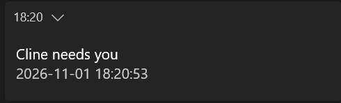

# cline-sentinel

A local Windows notifier for Cline: **one toast when a turn ends**, and silence while it is still
working.

Cline can run a long tool, wait for an approval, or stop on an error while you are away from the
screen. Cline Desktop 0.0.48 exposes notification toggles, but on Windows it reports
`Notifications are blocked` and is absent from the notification-sender list
([cline/cline#15267](https://github.com/cline/cline/issues/15267), open). An earlier report documents
two Cline sender IDs and a PowerShell toast AppID mismatch
([cline/cline#14594](https://github.com/cline/cline/issues/14594), open). This tool is an independent
fallback: it reads Cline's local event database and does not call a model, use the network, depend on
Cline hooks, or keep turn state in model memory.

- Windows 10/11, Python 3.8+, standard library only.
- Read-only access to `%USERPROFILE%\.cline\data\db\hub-events-*.db`.
- One resident process plus one scheduled health check.
- Not affiliated with Cline.
- Release: [1.0.1](https://github.com/55093693k-dot/cline-sentinel/releases/tag/1.0.1).

## Why a turn-end notifier

An ordinary "task finished" hook is not enough. Current Cline builds can emit `run.failed` when a
turn stops on an error (for example, quota exhaustion) **without** an `agent.done` event. A notifier
that watches only `agent.done` misses exactly the case where you are most needed.

This tool treats any terminal event as the end of a turn:

`agent.done` / `run.completed` / `run.aborted` / `run.failed`

It also notices two other situations: a run that produces no event for 30 minutes, and a tool call
that stays open while nothing else happens. Mid-run silence alone is not a notification.

This is not a hook. A hook is a separate callback; this reader follows the append-only event stream
and keeps its cursor on disk. It does not use model memory or a prompt-side instruction.

## What a notification looks like



*Captured from the Windows notification centre. The card title is always `Cline needs you`; this
collapsed view shows the title and time, while the body carries the case-specific reason or parked
tool. See the table below for the body variants.*

## Quick start

The examples put the folder at `%USERPROFILE%\tools\cline-sentinel`; any fixed folder works.

### 1. Put the files in one folder

```text
cline-sentinel\
├─ cline_notify.py
├─ toast.ps1
├─ guard.ps1
├─ install.ps1
├─ launch\
│  ├─ notify.cmd
│  ├─ notify.vbs
│  └─ guard.vbs
├─ config.example.json
└─ tests\
```

### 2. Create the configuration

```powershell
Copy-Item .\config.example.json .\config.json
```

The defaults work without editing:

| Setting | Empty means |
|---|---|
| `hub_db` | auto-select the newest `%USERPROFILE%\.cline\data\db\hub-events-*.db` |
| `toast_ps1` | `toast.ps1` next to `cline_notify.py` |
| `log_dir` | `logs` next to `cline_notify.py` |
| `toast_aumid` | auto-select a registered sender that allows banners |
| `toast_sound` | system notification WAV |

### 3. Dry run and test the notification

```powershell
python .\cline_notify.py --replay
python .\cline_notify.py --test
```

`--replay` counts how many turn-end notifications the existing database would produce. It does not
change state or show a toast. On a fresh database the number can be zero.

`--test` shows one toast. Read the last line of `logs\toast_notify.log`:

```text
OK  2026-11-01 12:00:00  aumid=<id>  setting=Enabled  banner=allow  sound=wav  Cline needs you
```

`aumid=` is the sender that accepted the call. `setting=Enabled` is the OS view of that sender's
channel; any other value means the sender is blocked. `banner=allow` means that sender has
`ShowBanner=1`; `deny` or `unset` means Windows may accept the call and still show nothing. The
sender is logged, so it is never a guess.

### 4. One manual pass

```powershell
python .\cline_notify.py --once
```

A healthy run prints `no verdict` when there is nothing to report. A real turn end prints one line
with `toast_rc=0`.

### 5. Install the logon task and the guard

```powershell
powershell -NoProfile -ExecutionPolicy Bypass -File .\install.ps1 -Preview
powershell -NoProfile -ExecutionPolicy Bypass -File .\install.ps1
```

This registers:

- `ClineNotify` — runs `cline_notify.py --follow` at logon.
- `ClineNotifyGuard` — starts two minutes after installation, then every five minutes; restarts the
  notifier if its heartbeat is older than 600 seconds, or if the heartbeat reports 3 consecutive
  database read failures (`db_fail >= 3`). The schedule survives a reboot.

The guard can also keep **one optional peer task** healthy. This is **off by default**, so installing
this tool does not manage another tool's scheduled tasks. To enable it, set the environment variable
`CLINE_GUARD_PEER_TASK` to a task name, for example `Sim_Sentinel_1min`: `Disabled` → enable + start,
non-zero `LastTaskResult` → stop + start, last run older than five minutes → start. A missing task is
a no-op; unset the variable or set it to `-` to keep the guard independent.

The installer also **starts `ClineNotify` immediately**, so the first notification does not wait for a
logout. It prints `started: ClineNotify (state=..., watcher processes=1)`; if that count is 0, check
`logs\guard.log` and `python .\cline_notify.py --once`. If a watcher is already running, the installer
reports it and does not start a second one. Pass `-NoStart` to register only and let the next logon
start it.

Both tasks start through `wscript` wrappers with a hidden window; no console should flash at logon or
every five minutes. If a console still appears, inspect the task action with
`Get-ScheduledTask -TaskName ClineNotify`.

Remove both tasks **and the running watcher process** with:

```powershell
powershell -NoProfile -ExecutionPolicy Bypass -File .\install.ps1 -Remove
```

Unregistering a task does not stop a process that is already running, so `-Remove` also stops any
`python.exe` / `pythonw.exe` whose command line mentions `cline_notify.py` (it prints
`stopped process: ... (pid N)`). `-Remove -Preview` shows what would be removed and stopped.

### 6. Verify it is alive

```powershell
Get-ScheduledTaskInfo -TaskName 'ClineNotify' | Select-Object LastRunTime, LastTaskResult
Get-Content .\logs\heartbeat.json
Get-Content .\logs\events_notify.jsonl -Tail 3
```

`heartbeat.json` is rewritten every couple of seconds. `events_notify.jsonl` gets exactly one line
per announced turn.

## What it reports

| Trigger | Rule | Threshold |
|---|---|---|
| Turn ends | any terminal event, once per run | immediate |
| Run never ends | `run.started` followed by no event at all | 1800 s |
| Tool is parked | newest open `tool.started` has no matching `tool.finished`, no event after it, and no `tool.updated` progress | `ask_question`: 15 s; other tools: 60 s |

The title is always `Cline needs you`; the body changes with the case:

| Case | Title | Body |
|---|---|---|
| Turn ends: completed | `Cline needs you` | local time, `reason=completed`, last useful line |
| Turn ends: failed / aborted | `Cline needs you` | local time, `reason=error` or `reason=aborted`, error or last line |
| Waiting for an answer or approval | `Cline needs you` | local time, `tool ask_question pending N s` (the tool name may differ) |
| No activity for 30 min | `Cline needs you` | local time, `reason=no-activity`, `run never ended` |
| Manual test | `Cline needs you` | `self-test`, local time |

There are **no different titles or banner styles per case**. Windows may show a different sender
label, but the card layout is the same; one screenshot represents the notification. Body text is the
only state-specific part. A question and an approval prompt share the parked-tool path.

**Not notified:** a normal quiet stretch, a slow tool that reports progress, a single failed tool
call that Cline retries, heartbeats, and `session.status` changes. Those events cannot distinguish
"working" from "waiting for a human".

## Deduplication and false-alarm guards

1. **One key per run.** A terminal event and its siblings produce the same `run:<id>` key, so
   `agent.done` plus `run.completed` yields one toast, not two.
2. **Progress is activity.** A long tool that keeps writing `tool.updated` is alive. The parked
   check measures time since the last progress, not time since the call started.
3. **Only the newest open call counts.** A stale record from an aborted run is discarded after
   30 minutes, and an event after an open call cancels the parked verdict.
4. **First start is silent.** On the first run, the cursor is moved to the end of the database, so
   history is not replayed as a burst of notifications.
5. **A broken reader says so.** Database failures print `DB READ FAILED`; "cannot read" must not
   look like "nothing happened".

## Sender identity and sound

Windows does not guarantee that a successful `Show()` call produces a visible banner. The sender's
AUMID must be allowed to display notifications.

`toast.ps1` tries, in order:

1. the AUMID in `config.json` (`toast_aumid`), when set;
2. installed AUMIDs whose per-app settings contain `ShowBanner=1`;
3. the built-in PowerShell IDs.

The accepted AUMID and its `banner=` state go into `logs\toast_notify.log`. If no sender is allowed,
the fallback can still accept the call with `banner=unset`. Focus assist or the global notification
switch can still suppress the banner; no program can prove that a person saw it.

The toast itself is silent. `toast.ps1` plays
`%SystemRoot%\Media\Windows Notify System Generic.wav` and falls back to a console beep. This keeps
the sound working when a borrowed AUMID suppresses the XML `<audio>` element. The log records
`sound=wav`, `beep`, or the failure state.

### Custom sound

Use a standard WAV file and set `toast_sound` in `config.json`:

```json
{
  "toast_sound": "%USERPROFILE%\\Sounds\\cline-done.wav"
}
```

Leave it empty for the system sound. `%USERPROFILE%` and `~` are expanded. The file is played
directly by `System.Media.SoundPlayer`; MP3 and other formats are not decoded, so use WAV.

If the custom path is wrong or the file is unreadable, the tool falls back to the system WAV and then
to a beep. The `sound=` field distinguishes `custom`, `wav`, `custom-missing+default`, and the beep
variants. Sound can still be lost if the system is muted, the volume is too low, no output device is
available, or the task did not run. That is independent of banner visibility: Focus assist can hide
the banner while the sound still plays.

## Notification and sound failure boundaries

| Layer | What can fail | Evidence | Can the tool fix it? |
|---|---|---|---|
| Sender | AUMID is not registered, or per-app banners are off | `setting=` / `banner=` in `logs\toast_notify.log` | Choose another `toast_aumid`; the tool cannot register an app identity |
| Windows policy | Focus assist, global notifications, or another desktop policy hides the banner | `setting=Enabled` and `banner=allow`, but no banner | No; this is outside the process |
| Execution | Task disabled, PC asleep, or the database cannot be read | `heartbeat.json` stale, no new `events_notify.jsonl`, or `DB READ FAILED` | The guard can restart the notifier, not Windows or a sleeping PC |
| Hub lifecycle | Cline stops or restarts before a run starts; there is no `run.started` | no event at all; this is indistinguishable from an idle Cline | No; the notifier follows the event stream, not Cline's process |
| Database replacement | Cline switches to a different `hub-events-*.db` | the watcher resolves the newest path on every poll and resets its cursor on a path change | A same-name replacement that reuses old sequence numbers may still need a restart |
| Sound | Custom WAV missing/corrupt, system muted, low volume, or no output device | `sound=` in the toast log | Missing/broken WAV falls back to the system WAV/beep; volume and device are outside the tool |

A banner can be hidden while the sound still plays, or the sound can fail while the banner is shown.
`setting=Enabled` is not proof that a banner appeared; `OK` in the toast log only means the call
returned. The event log is evidence of a decision, not proof that a person saw the card.

## Configuration

| Key | Default | Meaning |
|---|---|---|
| `hub_db` | empty | event database; empty selects the newest matching file |
| `toast_ps1` | empty | notifier script; empty uses the file next to the program |
| `log_dir` | empty | state and logs; empty uses `.\logs` |
| `poll_interval_s` | `2.0` | database polling interval |
| `parked_after_s` | `60` | ordinary tool threshold |
| `fast_tools` | `{"ask_question": 15}` | per-tool parked thresholds |
| `hung_after_s` | `1800` | no-event threshold for an open run |
| `toast_aumid` | empty | explicit sender AUMID; empty enables detection |
| `toast_sound` | empty | custom WAV path; empty uses the system notification WAV |

Paths may be absolute or use `%USERPROFILE%` / `~`. Relative paths are resolved next to
`cline_notify.py`.

## Troubleshooting

| Symptom | Check |
|---|---|
| No toast at all | Is `cline_notify.py --follow` running? Is `logs\heartbeat.json` younger than 600 s? Does `db_fail` stay at 0? Does `hub_db` exist? |
| `DB READ FAILED` | Cline's database path or schema changed; run `--replay` against the current database. The guard restarts after 3 consecutive failures; `--once` exits with code 2. |
| Toast log says `OK` but no banner | Is `banner=allow`? If not, set `toast_aumid` or allow that sender in Windows notifications. If yes, check Focus assist and the global switch. |
| Too many notifications | Increase `parked_after_s`; remove a tool from `fast_tools` |
| No sound | Check system volume and the `sound=` field in the toast log |
| Old toast after restart | Inspect `logs\state_notify.json`; the `pending` entry should be discarded if it is older than 30 minutes |
| Task says it ran but nothing happens | Run `python .\cline_notify.py --once` directly and read its output; the task history alone is not evidence that the process started |

## Known limits

- **Cline-specific.** The SQLite schema is an implementation detail of Cline. A future version may
  rename events or payload fields. Run `--replay` after upgrading.
- **No network or model calls.** It cannot see a turn that never reached the local database.
- **The approval prompt is not separately verified.** It shares the parked-tool code path, but only
  `ask_question` was observed on the test machine. Auto-approval hides approval prompts.
- **The guard has no layer below it.** If the guard task is disabled or the computer is off, nothing
  restarts the notifier or delivers missed events.
- **A hub failure before a turn is silent.** The notifier follows `hub_events`, not the Cline process.
  If Cline dies or restarts before a `run.started` exists, there is no turn event; an idle Cline and a
  dead hub look identical. This cannot be turned into a reliable "turn aborted" toast without a
  separate hub heartbeat or process signal.
- **A hub failure during a turn is delayed.** If `run.started` was recorded, the 30-minute
  no-activity rule can fire while the database is still readable. If the database becomes unreadable,
  the notifier logs `DB READ FAILED`, writes `db_fail`, and `--once` exits with code 2; the guard
  restarts the watcher after 3 consecutive failures, but it cannot send a turn toast by itself.
- **Database changes are followed, with one caveat.** The watcher resolves `hub-events-*.db` on every
  poll and resets its cursor when the path changes. A replacement that keeps the same filename and
  reuses old sequence numbers may still need a manual `ClineNotify` restart.
- **The event log may contain snippets.** `events_notify.jsonl` stores the last line of a turn for
  diagnosis; treat `logs\` as private and do not attach it to a public issue.
- **A banner is not proof of reading.** Windows decides whether a notification is visible.


## Tests

The sandbox suite creates a temporary database and never reads real Cline data or shows a toast:

```powershell
python -m unittest discover -s tests -v
```

It covers the four terminal events, duplicate suppression, orphan terminal events, database switches,
the 30-minute hang rule, the 15/60-second parked thresholds, progress updates, stale calls,
first-start silence, and the `--once` DB-failure exit code.

## Files

| File | Purpose |
|---|---|
| `cline_notify.py` | event reader, verdicts, deduplication, toast call |
| `toast.ps1` | AUMID selection, banner state, sound, one-line log |
| `guard.ps1` | heartbeat check and restart |
| `install.ps1` | Task Scheduler registration in preview, apply, or remove mode |
| `launch\` | hidden `wscript` wrappers for the notifier and guard |
| `config.example.json` | all settings, no personal paths |
| `tests\test_cline_notify.py` | 20 sandbox tests |

## Uninstall and cleanup

Remove both scheduled tasks first:

```powershell
powershell -NoProfile -ExecutionPolicy Bypass -File .\install.ps1 -Remove
```

If the repository has already been deleted, remove them directly:

```powershell
Unregister-ScheduledTask -TaskName 'ClineNotify','ClineNotifyGuard' -Confirm:$false
```

Then remove only the tool's own files:

- The extracted repository folder, including `config.json`.
- The repository's `logs\` directory (`state_notify.json`, `events_notify.jsonl`,
  `toast_notify.log`, and `heartbeat.json`).
- Any custom WAV path or `toast_aumid` entry in the removed `config.json`.

**Do not delete `%USERPROFILE%\.cline\data\db\` or any Cline session.** The tool opens that database
read-only; removing its own `logs\` does not remove Cline data.

## Safety and security

`cline-sentinel` is a local event reader. It does not modify Cline data, edit workspace files, start
or kill Cline, change Windows settings, or shut down the computer. It runs with the current user's
permissions and does not use the network, a model, telemetry, a service, a driver, a hook, or model
memory.

It still creates state and notification records under `logs/`; treat those files as private. Windows,
Python, Cline, and the hardware can fail independently, so no software can guarantee that a machine
will never crash. See [SECURITY.md](SECURITY.md) for the precise scope and reporting guidance.

## Licence

Copyright (c) 2026 Chan Kingho.

Source code, tests, and PowerShell scripts are MIT; written documentation and the screenshot are
CC BY 4.0. See [LICENSE](LICENSE) and [LICENSE-docs.md](LICENSE-docs.md).

Cline is a third-party product. This repository is an independent local utility and is not
affiliated with or endorsed by Cline.

